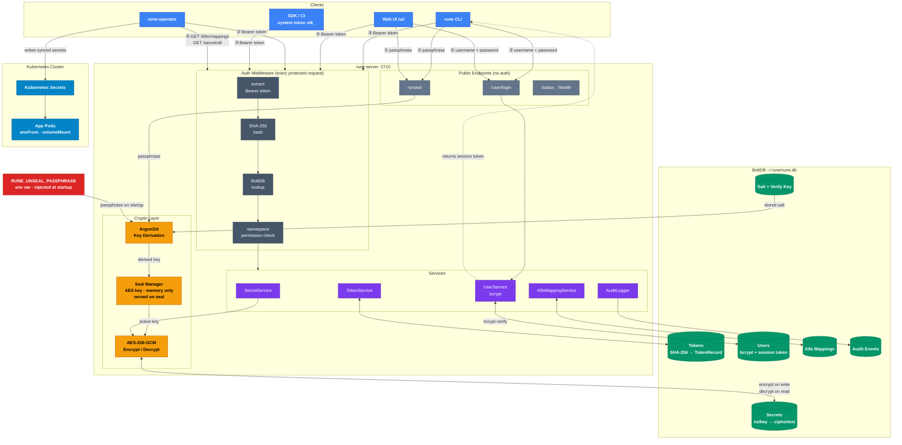

<p align="center">
  
</p>

<h1 align="center">Rune</h1>

<p align="center">
  <strong>A minimal, secure, self-hosted secrets manager.</strong><br/>
  Lightweight. Encrypted. Local-first.
</p>

<p align="center">
  
  
  
  
</p>

---

## Table of Contents

- [Overview](#overview)
- [What's New in v1.0.1-RC](#whats-new-in-v101-rc)
- [Features](#features)
- [Architecture](#architecture)
- [Installation](#installation)
- [Updating Rune](#updating-rune)
- [Getting Started](#getting-started)
- [Multi-Developer Auth](#multi-developer-auth)
- [Kubernetes Operator](#kubernetes-operator)
- [Operator Deployment Guide — Kind & EKS](#operator-deployment-guide--kind--eks)
- [Deploying on AWS EC2](#deploying-on-aws-ec2)
- [CLI Reference](#cli-reference)
- [API Reference](#api-reference)
- [Data Storage](#data-storage)
- [Security Model](#security-model)
- [Roadmap](#roadmap)
- [Contributing](#contributing)
- [Philosophy](#philosophy)
- [License](#license)

---

## What's New in v1.0.1-RC

### Multi-Developer Auth
Rune can now be shared across a team without exposing the master passphrase. Admins create username + password accounts for developers via the new **Users** view. Each user gets their own session token scoped to specific namespaces and permissions. Developers log in with familiar credentials instead of pasting a 64-character hex token.

### Auto-Unseal
Set `RUNE_UNSEAL_PASSPHRASE` in your deployment environment and the vault unseals itself automatically on every restart. Developers never see the passphrase screen.

### Kubernetes Operator
Rune now ships a Kubernetes operator (`rune-operator`) that syncs secrets from Rune namespaces directly into Kubernetes Secrets. Create a mapping in the UI or via API — the operator watches for changes and keeps your cluster in sync.

### TTL-Based Auto-Rotation
Secrets can now have a TTL (`30s`, `1h`, `7d`, `90d`, etc.). When a secret expires, the vault's background scheduler rotates it automatically and logs the event in the audit log. Set TTLs from the CLI with `rune put --ttl` or `rune set-ttl`, or from the UI.

### `rune update`
The CLI can now update itself in-place. Run `rune update` and it will check for the latest release on GitHub, download the right binary for your platform, and replace itself atomically.

---

## Overview

Rune is a lightweight, self-hosted secrets manager built for developers who want full control over their secrets without the overhead of complex infrastructure.

It provides AES-256-GCM encrypted storage, a secure seal/unseal lifecycle, namespace-based isolation, secret versioning, and token-based authentication — all in a single binary with zero external dependencies. Access your vault through the built-in web UI or the `rune` CLI.

> **Rune is not a replacement for enterprise secrets management.** It's a focused tool for developers who want a simple, auditable, and self-contained solution.

---

## Features

| Feature | Description |
|---|---|
| **AES-256-GCM Encryption** | Secrets are encrypted at rest using industry-standard authenticated encryption |
| **Argon2id Key Derivation** | Passphrase-based key derivation — resistant to brute-force and GPU attacks |
| **Seal / Unseal Lifecycle** | Vault starts sealed on every launch; no secrets accessible until explicitly unlocked |
| **Token Authentication** | All protected endpoints require a valid token; tokens are SHA-256 hashed before storage |
| **Permission-based Tokens** | Tokens carry per-namespace permissions: `read`, `write`, `delete`, `rotate` |
| **Namespaces** | Isolate secrets by team, service, or environment with fine-grained token access |
| **Secret Versioning** | Full history and point-in-time retrieval for every secret |
| **Secret Rotation** | Rotate secret values on demand; previous versions are preserved |
| **System Tokens** | Read-only tokens with dual-encrypted sealed access for CI/CD and SDK use |
| **Web UI** | Built-in React dashboard for managing secrets, tokens, namespaces, and vault stats |
| **JSON / .env Import** | Bulk-import secrets from a `.json` or `.env` file directly into any namespace |
| **CLI Interface** | Full-featured command-line tool for all vault operations |
| **Zero External Dependencies** | No cloud services, no agents, no sidecars — just a single binary |
| **TTL-Based Auto-Rotation** | Set a TTL on any secret (`30s` min); the scheduler rotates it automatically when it expires |
| **Multi-Developer Auth** | Username + password accounts backed by scoped session tokens — no passphrase sharing |
| **Auto-Unseal** | Set `RUNE_UNSEAL_PASSPHRASE` to unseal the vault automatically on startup |
| **Audit Log** | Tamper-resistant log of every read, write, rotate, login, and admin action |
| **Kubernetes Operator** | Sync Rune secrets into Kubernetes Secrets automatically via the `rune-operator` |
| **BoltDB Storage** | Embedded key-value store — the same underlying engine powering etcd |

---

## Architecture

Rune ships two binaries that work together:

```
┌──────────────────┐              ┌───────────────────────────┐
│   rune CLI       │   HTTP API   │       rune-server         │
│   (client)       │ ───────────► │       :2710               │
└──────────────────┘              │                           │
                                  │  ┌─────────────────────┐  │
┌──────────────────┐              │  │   AES-256-GCM Vault │  │
│   Web Browser    │   HTTP API   │  │   (BoltDB)          │  │
│   /ui/           │ ───────────► │  └─────────────────────┘  │
└──────────────────┘              └───────────────────────────┘
```

- **`rune-server`** — the vault daemon. Manages encryption, exposes the HTTP API, and serves the embedded web UI at `/ui/`
- **`rune`** — the CLI client that communicates with the server over HTTP
- **Web UI** — a React + Tailwind dashboard embedded in the server binary, accessible in any browser

### Full System Workflow



| Flow | Description |
|---|---|
| **① Unseal** | Passphrase → Argon2id (with stored salt) → AES-256 key → held in Seal Manager in memory. Sealing zeros the key instantly — no restart needed. |
| **② Login** | Username + password → bcrypt verify against `__rune_users` → session token returned. Token flows through existing auth middleware on every subsequent request. |
| **③ Auth** | Every protected request: extract Bearer token → SHA-256 hash → BoltDB lookup → namespace permission check. Never stores raw tokens. |
| **④ Secret I/O** | Write: plaintext → AES-256-GCM (unique nonce) → ciphertext stored in BoltDB. Read: ciphertext → decrypt with in-memory key → plaintext. All reads/writes are audit-logged. |
| **⑤ K8s Sync** | `rune-operator` authenticates with a token, fetches mappings + secrets from Rune, then writes native Kubernetes Secrets in the target namespace. Runs on a configurable interval per mapping. |

---

## Installation

### macOS / Linux

```bash
curl -fsSL https://raw.githubusercontent.com/runelock-io/rune/main/scripts/install.sh | bash
```

### Verify the installation

```bash
rune --version
rune-server --version
```

> Binary releases for other platforms are available on the [Releases](https://github.com/runelock-io/rune/releases) page.

---

## Updating Rune

### CLI — one command

If you have `rune` v1.0.1-RC or later installed:

```bash
rune update
```

It checks GitHub for the latest release, downloads the right binary for your platform, and replaces itself in-place.

```
Current version: v1.0.1-RC
Checking for updates... done
New version available: v1.0.2
Downloading rune_darwin_arm64... done
✔ Updated to v1.0.2 — restart your shell if needed
```

### CLI — manual (older installs)

If you're on a version before `rune update` was added, download the new binary manually:

```bash
# macOS (Apple Silicon)
curl -L https://github.com/runelock-io/rune/releases/latest/download/rune_darwin_arm64 -o rune
chmod +x rune && sudo mv rune /usr/local/bin/rune

# macOS (Intel)
curl -L https://github.com/runelock-io/rune/releases/latest/download/rune_darwin_amd64 -o rune
chmod +x rune && sudo mv rune /usr/local/bin/rune

# Linux (amd64)
curl -L https://github.com/runelock-io/rune/releases/latest/download/rune_linux_amd64 -o rune
chmod +x rune && sudo mv rune /usr/local/bin/rune

# Linux (arm64)
curl -L https://github.com/runelock-io/rune/releases/latest/download/rune_linux_arm64 -o rune
chmod +x rune && sudo mv rune /usr/local/bin/rune
```

### Server — manual update

```bash
# Stop the server
sudo systemctl stop rune

# Download the new server binary (example: Linux amd64)
curl -L https://github.com/runelock-io/rune/releases/latest/download/rune-server_linux_amd64 -o rune-server
chmod +x rune-server && sudo mv rune-server /usr/local/bin/rune-server

# Restart
sudo systemctl start rune
```

> The database (`~/.rune/rune.db`) is never touched during an update. All secrets, tokens, namespaces, and audit events are preserved.

---

## Getting Started

### Step 1 — Start the server

```bash
rune-server
```

On first launch, Rune prompts for a passphrase and generates a root token:

```
  Set a passphrase: ••••••••••••••

  ────────────────────────────────────────────────────────────────────────────
  root token
  ────────────────────────────────────────────────────────────────────────────

  rnk_92776b83307767ff9d7be381ffae323a07131f98b34e1842fb7f3206771c7b51

  ────────────────────────────────────────────────────────────────────────────
  shown once  ·  not stored  ·  full vault access
  ────────────────────────────────────────────────────────────────────────────
```

> **Save your root token immediately.** It cannot be recovered after this point.

The web UI is available at **[http://localhost:2710/ui/](http://localhost:2710/ui/)** once the server is running.

---

### Step 2 — Unseal the vault

The vault starts **sealed** on every launch. Unseal it with your passphrase:

```bash
rune unseal
```

```
Enter passphrase: ••••••••••••••
✓ Vault unsealed.
```

---

### Step 3 — Login

Authenticate the CLI with your root token:

```bash
rune login rnk_92776b83307767ff9d7be381ffae323a07131f98b34e1842fb7f3206771c7b51
```

The token is stored locally at `~/.rune/config.json`.

---

### Step 4 — Store a secret

```bash
rune put db/password my-secret-value
```

---

### Step 5 — Retrieve a secret

```bash
rune get db/password
```

```
my-secret-value
```

---

### Step 6 — Seal the vault

When you're done, seal the vault to make all secrets inaccessible:

```bash
rune seal
```

```
✓ Vault sealed.
```

---

## Multi-Developer Auth

Rune supports shared deployments where multiple developers each have their own account — without anyone seeing the master passphrase.

### How it works

1. **Admin** deploys Rune and sets `RUNE_UNSEAL_PASSPHRASE` in the server environment (systemd, docker-compose, etc.)
2. **Admin** creates user accounts in the **Users** view (root-only), assigning each user a username, password, and namespace permissions
3. **Developer** opens the Rune UI → logs in with username + password
4. The server returns a scoped session token — the developer never touches the raw token

Each user account has its own session token with the exact namespace permissions the admin configured. Revoking a user immediately invalidates their session.

### Auto-unseal

Add `RUNE_UNSEAL_PASSPHRASE` to your server environment so the vault unseals itself on every restart:

```bash
# systemd unit
[Service]
ExecStart=/usr/local/bin/rune-server
Environment=RUNE_UNSEAL_PASSPHRASE=your-passphrase
```

```bash
# Docker
docker run -e RUNE_UNSEAL_PASSPHRASE=your-passphrase runelock/rune-server
```

If the env var is set but the passphrase is wrong, the server logs a warning and starts sealed — it never silently fails.

### Creating a user (API)

```bash
curl -X POST http://localhost:2710/user/create \
  -H "Authorization: Bearer <root-token>" \
  -H "Content-Type: application/json" \
  -d '{
    "username": "alice",
    "password": "correct-horse-battery",
    "namespaces": [
      {"namespace": "production", "permissions": ["read"]},
      {"namespace": "staging",    "permissions": ["read", "write", "rotate"]}
    ]
  }'
```

### Developer login (API)

```bash
curl -X POST http://localhost:2710/user/login \
  -H "Content-Type: application/json" \
  -d '{"username": "alice", "password": "correct-horse-battery"}'

# → {"token": "rnk_..."}
```

The returned token flows through the existing auth middleware — the developer can then use it with the CLI or any SDK.

---

## Kubernetes Operator

The `rune-operator` syncs secrets from a Rune namespace into native Kubernetes Secrets automatically. Configure a mapping once — the operator watches for changes and keeps your cluster in sync.

### How it works

1. Run `rune-operator` in your cluster (it connects to your Rune server over HTTP)
2. Create a **mapping** in the Rune UI (**Kubernetes** view) or via API
3. The operator reads the specified keys from the Rune namespace and writes them into a Kubernetes Secret in the target namespace
4. On each sync cycle (configurable interval), it re-reads from Rune and updates the K8s Secret if anything changed

### Creating a mapping (API)

```bash
curl -X POST http://localhost:2710/k8s/mapping/create \
  -H "Authorization: Bearer <root-token>" \
  -H "Content-Type: application/json" \
  -d '{
    "name":              "prod-db-creds",
    "rune_namespace":    "production",
    "keys":              ["db/password", "db/host", "api/key"],
    "target_secret":     "prod-secrets",
    "target_k8s_ns":     "default",
    "secret_type":       "Opaque",
    "refresh_interval":  "5m"
  }'
```

| Field | Description |
|---|---|
| `name` | Human-readable name for the mapping |
| `rune_namespace` | The Rune namespace to read secrets from |
| `keys` | List of secret keys to sync — leave empty to sync all keys in the namespace |
| `target_secret` | Name of the Kubernetes Secret to create/update |
| `target_k8s_ns` | Kubernetes namespace where the Secret lives |
| `secret_type` | Kubernetes Secret type — `Opaque`, `kubernetes.io/tls`, etc. |
| `refresh_interval` | How often the operator re-syncs (e.g. `1m`, `5m`, `1h`) |

> **Key name transformation:** Kubernetes Secret keys only allow `[-._a-zA-Z0-9]+`. The operator automatically replaces `/` with `_` when writing keys, so `db/password` becomes `db_password` and `api/key` becomes `api_key` inside the Kubernetes Secret. Keep this in mind when referencing keys in your Pod specs.

### Checking sync status

```bash
curl http://localhost:2710/k8s/mapping/status \
  -H "Authorization: Bearer <root-token>"

# → {"mapping_id": "...", "last_sync": "...", "status": "synced", "secret_count": 3}
```

Sync status is also visible in the **Kubernetes** view in the web UI, showing `synced`, `pending`, or `error` per mapping.

### Deploying the operator

**Quickest path — one interactive script:**

```bash
bash config/operator/setup.sh
```

It prompts for your Rune server URL and token, creates the `rune-system` namespace, stores the credentials as a Kubernetes Secret, deploys the operator, and waits for the rollout to complete.

**Manual — one command:**

```bash
kubectl create namespace rune-system

kubectl create secret generic rune-operator-credentials \
  --namespace rune-system \
  --from-literal=RUNE_SERVER="http://<your-rune-server>:2710" \
  --from-literal=RUNE_TOKEN="rnk_<your-token>"

kubectl apply -f config/operator/deploy.yaml
```

**Using the example manifest:**

```bash
# Copy, fill in your values, then apply both files together
cp config/operator/secret.example.yaml config/operator/secret.yaml
# Edit secret.yaml — replace <your-rune-server> and rnk_<your-token>
kubectl apply -f config/operator/secret.yaml -f config/operator/deploy.yaml
```

> `secret.example.yaml` includes the `rune-system` Namespace resource so you can apply it in any order without getting a "namespace not found" error. Never commit `secret.yaml`.

---

## Operator Deployment Guide — Kind & EKS

This guide walks through deploying `rune-operator` end-to-end — first on a local **Kind** cluster for development and testing, then on a production **EKS** cluster.

The operator image is hosted publicly at `ghcr.io/runelock-io/rune-operator:latest` — no registry authentication is needed to pull it.

---

### Part 1 — Kind (Local Development)

Kind runs a full Kubernetes cluster inside Docker containers on your laptop. It is the fastest way to test the operator without any cloud account.

#### Prerequisites

```bash
# macOS
brew install kind kubectl

# Linux
curl -Lo ./kind https://kind.sigs.k8s.io/dl/v0.23.0/kind-linux-amd64
chmod +x ./kind && sudo mv ./kind /usr/local/bin/kind

# Verify
kind --version
kubectl version --client
```

You also need Docker running and a Rune server reachable from inside the Kind cluster. The easiest setup is to run `rune-server` on your Mac/Linux host and expose it to Kind containers via your host's gateway IP.

---

#### Step 1 — Create a Kind cluster

```bash
kind create cluster --name rune-dev
```

Confirm kubectl is pointing at it:

```bash
kubectl cluster-info --context kind-rune-dev
```

Expected output:

```
Kubernetes control plane is running at https://127.0.0.1:<port>
```

---

#### Step 2 — Start and configure Rune

If you do not already have a running Rune server, start one locally:

```bash
rune-server
# → first-launch wizard: set passphrase, copy root token
rune unseal
rune login rnk_<your-root-token>
```

Create a namespace and add some secrets that will be synced:

```bash
rune namespace create production

rune put db/password "super-secret-db-pass" -n production
rune put db/host "postgres.internal:5432" -n production
rune put api/key "sk_live_abc123def456" -n production
```

Verify the secrets are there:

```bash
rune list -n production
```

---

#### Step 3 — Determine the Rune server URL for Kind

Kind containers cannot reach `localhost` on your host machine. Use your host's Docker bridge IP instead:

```bash
# macOS — use host.docker.internal (Kind supports it natively)
RUNE_URL="http://host.docker.internal:2710"

# Linux — find the bridge IP
docker network inspect kind | grep Gateway
# example output: "Gateway": "172.18.0.1"
RUNE_URL="http://172.18.0.1:2710"
```

Verify the URL is reachable from inside Kind by running a quick curl from a pod:

```bash
kubectl run curl-test --image=curlimages/curl --rm -it --restart=Never -- \
  curl -s http://host.docker.internal:2710/status
# → {"sealed":false}
```

If you see `{"sealed":false}`, the operator will be able to reach your Rune server.

---

#### Step 4 — Deploy the operator

The setup script handles everything — namespace, credentials secret, and deployment in one go:

```bash
bash config/operator/setup.sh
# → prompts for Rune server URL and token, then deploys
```

Or manually in one command:

```bash
kubectl create namespace rune-system

kubectl create secret generic rune-operator-credentials \
  --namespace rune-system \
  --from-literal=RUNE_SERVER="http://host.docker.internal:2710" \
  --from-literal=RUNE_TOKEN="rnk_<your-root-token>"

kubectl apply -f config/operator/deploy.yaml
```

Watch the pod come up:

```bash
kubectl rollout status deployment/rune-operator -n rune-system
```

Expected output:

```
deployment "rune-operator" successfully rolled out
```

Check the logs to confirm it connected and synced:

```bash
kubectl logs -n rune-system -l app=rune-operator -f
```

Expected log lines:

```
rune-operator started  server=http://host.docker.internal:2710  interval=60s
synced mapping "prod-db-creds" (default/prod-secrets) — 3 keys in 142ms
```

---

#### Step 6 — Create a mapping

A mapping tells the operator which Rune namespace to read from and which Kubernetes Secret to write to.

**Via the Rune UI:**

1. Open `http://localhost:2710/ui/`
2. Navigate to **Kubernetes** in the sidebar
3. Click **Add Mapping**
4. Fill in the fields:
   - **Name**: `prod-db-creds`
   - **Rune Namespace**: `production`
   - **Keys**: `db/password`, `db/host`, `api/key` (leave empty to sync all keys)
   - **Target K8s Secret**: `prod-secrets`
   - **Target K8s Namespace**: `default`
   - **Secret Type**: `Opaque`
   - **Refresh Interval**: `1m`

**Via API:**

```bash
curl -X POST http://localhost:2710/k8s/mapping/create \
  -H "Authorization: Bearer rnk_<your-root-token>" \
  -H "Content-Type: application/json" \
  -d '{
    "name":             "prod-db-creds",
    "rune_namespace":   "production",
    "keys":             ["db/password", "db/host", "api/key"],
    "target_secret":    "prod-secrets",
    "target_k8s_ns":    "default",
    "secret_type":      "Opaque",
    "refresh_interval": "1m"
  }'
```

The operator picks up new mappings on its next sync cycle (within 60 seconds, or instantly on startup).

---

#### Step 7 — Verify the Kubernetes Secret was created

```bash
kubectl get secret prod-secrets -n default
```

```
NAME           TYPE     DATA   AGE
prod-secrets   Opaque   3      12s
```

Inspect the values (they are base64-encoded — that is standard Kubernetes behaviour):

```bash
kubectl get secret prod-secrets -n default -o jsonpath='{.data}' | jq
```

```json
{
  "api_key":     "c2tfbGl2ZV9hYmMxMjNkZWY0NTY=",
  "db_host":     "cG9zdGdyZXMuaW50ZXJuYWw6NTQzMg==",
  "db_password": "c3VwZXItc2VjcmV0LWRiLXBhc3M="
}
```

> Keys with `/` are automatically renamed: `db/password` → `db_password`, `api/key` → `api_key`.

Decode a value to confirm it matches what you stored in Rune:

```bash
kubectl get secret prod-secrets -n default \
  -o jsonpath='{.data.db_password}' | base64 -d
# → super-secret-db-pass
```

---

#### Step 8 — Test live sync

Update a secret in Rune and watch the K8s Secret update automatically:

```bash
rune put db/password "new-rotated-password" -n production
```

Wait up to 1 minute (the mapping's `refresh_interval`), then check:

```bash
kubectl get secret prod-secrets -n default \
  -o jsonpath='{.data.db_password}' | base64 -d
# → new-rotated-password
```

---

#### Step 9 — Use the Secret in a Pod

Mount `prod-secrets` as environment variables in any workload:

```yaml
apiVersion: apps/v1
kind: Deployment
metadata:
  name: my-app
  namespace: default
spec:
  replicas: 1
  selector:
    matchLabels:
      app: my-app
  template:
    metadata:
      labels:
        app: my-app
    spec:
      containers:
        - name: my-app
          image: my-app:latest
          envFrom:
            - secretRef:
                name: prod-secrets
```

Or mount individual keys:

```yaml
env:
  - name: DB_PASSWORD
    valueFrom:
      secretKeyRef:
        name: prod-secrets
        key: db_password   # Rune key "db/password" → "db_password" in K8s
  - name: API_KEY
    valueFrom:
      secretKeyRef:
        name: prod-secrets
        key: api_key       # Rune key "api/key" → "api_key" in K8s
```

---

#### Cleanup

```bash
kind delete cluster --name rune-dev
```

---

### Part 2 — EKS (Production)

This section covers deploying `rune-operator` on an existing EKS cluster, pointing at a Rune server running on EC2 (see [Deploying on AWS EC2](#deploying-on-aws-ec2)).

#### Prerequisites

- AWS CLI configured: `aws configure`
- `kubectl` with EKS context: `aws eks update-kubeconfig --name <cluster-name> --region <region>`
- A running Rune server on EC2 (or another host reachable from the cluster)
- A Rune root or system token

---

#### Step 1 — Connect kubectl to your EKS cluster

```bash
aws eks update-kubeconfig \
  --name my-cluster \
  --region us-east-1

# Verify
kubectl get nodes
```

Expected output (nodes will vary):

```
NAME                           STATUS   ROLES    AGE   VERSION
ip-10-0-1-100.ec2.internal     Ready    <none>   2d    v1.30.0
ip-10-0-2-200.ec2.internal     Ready    <none>   2d    v1.30.0
```

---

#### Step 2 — Confirm the operator image is reachable

The image is hosted publicly on GitHub Container Registry. EKS nodes pull from the internet by default — no additional credentials are required.

```bash
# Optional: verify the image exists and is pullable
docker pull ghcr.io/runelock-io/rune-operator:latest
```

If your EKS nodes are in a private subnet without internet access, you will need to either:
- Mirror the image to ECR (see Step 2a below), or
- Configure a NAT Gateway for the node subnet

**Step 2a — Optional: Mirror to ECR (private clusters)**

```bash
AWS_ACCOUNT=$(aws sts get-caller-identity --query Account --output text)
AWS_REGION=us-east-1
ECR_REPO=$AWS_ACCOUNT.dkr.ecr.$AWS_REGION.amazonaws.com/rune-operator

# Create ECR repository
aws ecr create-repository --repository-name rune-operator --region $AWS_REGION

# Pull, tag, push
aws ecr get-login-password --region $AWS_REGION | \
  docker login --username AWS --password-stdin $AWS_ACCOUNT.dkr.ecr.$AWS_REGION.amazonaws.com

docker pull ghcr.io/runelock-io/rune-operator:latest
docker tag ghcr.io/runelock-io/rune-operator:latest $ECR_REPO:latest
docker push $ECR_REPO:latest
```

Then update `config/operator/deploy.yaml` to use your ECR URI:

```yaml
image: <aws_account_id>.dkr.ecr.us-east-1.amazonaws.com/rune-operator:latest
```

---

#### Step 3 — Ensure EKS nodes can reach the Rune server

The operator pods need outbound HTTP access to your Rune server. If Rune is running on EC2:

1. Open the **EC2 Security Group** attached to your Rune instance to allow inbound traffic on port `2710` from the EKS node security group (not from `0.0.0.0/0`):

```
Inbound rule:
  Type:   Custom TCP
  Port:   2710
  Source: <EKS node security group ID>   ← e.g. sg-0abc12345def
```

2. Find the EKS node security group:

```bash
aws eks describe-cluster --name my-cluster --region us-east-1 \
  --query "cluster.resourcesVpcConfig.clusterSecurityGroupId" \
  --output text
```

3. Test connectivity from inside the cluster:

```bash
kubectl run curl-test --image=curlimages/curl --rm -it --restart=Never -- \
  curl -s http://<ec2-private-ip>:2710/status
# → {"sealed":false}
```

> Use the **private IP** of the EC2 instance when both the instance and EKS cluster are in the same VPC. This keeps traffic on the internal network and avoids data transfer costs.

---

#### Step 4 — Deploy the operator

The setup script handles namespace creation, credentials, and deployment in one shot:

```bash
bash config/operator/setup.sh
# → prompts for Rune server URL and token, then deploys
```

Or manually:

```bash
kubectl create namespace rune-system

kubectl create secret generic rune-operator-credentials \
  --namespace rune-system \
  --from-literal=RUNE_SERVER="http://<ec2-private-ip>:2710" \
  --from-literal=RUNE_TOKEN="rnk_<your-token>"

kubectl apply -f config/operator/deploy.yaml
```

Verify the secret and deployment:

```bash
kubectl get secret rune-operator-credentials -n rune-system
```

This creates the following resources in your cluster:

| Resource | Name | Namespace |
|---|---|---|
| Namespace | `rune-system` | — |
| ServiceAccount | `rune-operator` | `rune-system` |
| ClusterRole | `rune-operator` | — |
| ClusterRoleBinding | `rune-operator` | — |
| Deployment | `rune-operator` | `rune-system` |

Wait for the rollout to complete:

```bash
kubectl rollout status deployment/rune-operator -n rune-system --timeout=120s
```

---

#### Step 6 — Verify the operator is running

Check the pod is in `Running` state:

```bash
kubectl get pods -n rune-system
```

```
NAME                             READY   STATUS    RESTARTS   AGE
rune-operator-7d8b9f6c4-xk2pq   1/1     Running   0          45s
```

Tail the logs to confirm it connected to Rune and synced successfully:

```bash
kubectl logs -n rune-system -l app=rune-operator --follow
```

```
rune-operator started  server=http://10.0.1.50:2710  interval=60s
synced mapping "prod-db-creds" (backend/app-secrets) — 5 keys in 89ms
```

If you see an error like `connection refused` or `no route to host`, re-check the security group rules from Step 3.

---

#### Step 7 — Create a Rune namespace and add secrets

On your Rune server (SSH into EC2 or use `rune --server http://<ec2-ip>:2710`):

```bash
rune namespace create production

rune put db/password  "prod-db-pass-xyz"       -n production
rune put db/host      "rds.us-east-1.amazonaws.com:5432" -n production
rune put db/name      "myapp_production"        -n production
rune put api/secret   "sk_live_prod_abc123"     -n production
rune put jwt/secret   "jwt-signing-secret-prod" -n production
```

---

#### Step 8 — Create a mapping

**Via API (from your local machine):**

```bash
curl -X POST http://<ec2-public-ip>:2710/k8s/mapping/create \
  -H "Authorization: Bearer rnk_<your-root-token>" \
  -H "Content-Type: application/json" \
  -d '{
    "name":             "prod-db-creds",
    "rune_namespace":   "production",
    "keys":             ["db/password", "db/host", "db/name", "api/secret", "jwt/secret"],
    "target_secret":    "app-secrets",
    "target_k8s_ns":    "backend",
    "secret_type":      "Opaque",
    "refresh_interval": "5m"
  }'
```

> Setting `keys` to an empty array (`[]`) syncs all secrets in the namespace into the Kubernetes Secret.

**Via the UI:**

Open `http://<ec2-public-ip>:2710/ui/` → **Kubernetes** → **Add Mapping**.

---

#### Step 9 — Verify the Kubernetes Secret

Create the target namespace if it does not exist:

```bash
kubectl create namespace backend
```

After the next sync cycle (at most 5 minutes, or restart the operator pod to force immediate sync):

```bash
kubectl get secret app-secrets -n backend
```

```
NAME          TYPE     DATA   AGE
app-secrets   Opaque   5      38s
```

Decode and verify values:

```bash
kubectl get secret app-secrets -n backend \
  -o jsonpath='{.data.db_password}' | base64 -d
# → prod-db-pass-xyz
```

Force an immediate sync by restarting the operator (safe — it re-reads all mappings on startup):

```bash
kubectl rollout restart deployment/rune-operator -n rune-system
kubectl logs -n rune-system -l app=rune-operator --follow
```

---

#### Step 10 — Use the Secret in your EKS workloads

```yaml
apiVersion: apps/v1
kind: Deployment
metadata:
  name: backend-api
  namespace: backend
spec:
  replicas: 3
  selector:
    matchLabels:
      app: backend-api
  template:
    metadata:
      labels:
        app: backend-api
    spec:
      containers:
        - name: backend-api
          image: myorg/backend-api:latest
          envFrom:
            - secretRef:
                name: app-secrets   # all Rune keys injected as env vars
          ports:
            - containerPort: 8080
```

Apply it:

```bash
kubectl apply -f backend-deployment.yaml
kubectl rollout status deployment/backend-api -n backend
```

---

#### Step 11 — Monitoring and debugging

**Check the liveness probe:**

The operator writes `/tmp/rune-operator-healthy` on startup. Kubernetes checks this file every 30 seconds. If the pod is in `CrashLoopBackOff`, the probe failed.

```bash
kubectl describe pod -n rune-system -l app=rune-operator
# Look for: Liveness probe failed: cat /tmp/rune-operator-healthy
```

**View sync status via the Rune API:**

```bash
curl http://<ec2-ip>:2710/k8s/mappings \
  -H "Authorization: Bearer rnk_<your-token>" | jq '.[].sync_status'
```

```json
{
  "mapping_id": "abc-123",
  "last_sync": "2025-11-25T14:32:00Z",
  "status": "synced",
  "secret_count": 5
}
```

**Common error causes:**

| Symptom | Likely cause | Fix |
|---|---|---|
| `connection refused` in logs | Security group blocking port 2710 | Add inbound rule for EKS node SG |
| `401 Unauthorized` in logs | Token is wrong or revoked | Re-create the credentials Secret |
| `sealed vault` error in logs | Rune server restarted without auto-unseal | Set `RUNE_UNSEAL_PASSPHRASE` on the server |
| `404 Not Found` for `/secret/all` | Rune namespace does not exist | Create it with `rune namespace create <name>` |
| Pod stuck in `Pending` | Image pull failure (private cluster) | Mirror image to ECR (see Step 2a) |

**Stream live operator logs:**

```bash
kubectl logs -n rune-system -l app=rune-operator --follow --tail=50
```

---

#### Production hardening checklist for EKS

| | Recommendation |
|---|---|
| **Dedicated token** | Create a system token scoped to only the namespaces the operator needs to read — do not use the root token in production |
| **Namespace scoping** | The operator's ClusterRole grants access to Secrets cluster-wide. Restrict it to specific namespaces with a Role + RoleBinding per namespace if your workloads are namespace-isolated |
| **Secret rotation** | The `rune-operator-credentials` Secret holds the token. Rotate it via `kubectl create secret --dry-run=client -o yaml \| kubectl apply -f -` |
| **TLS** | Put Rune behind a TLS-terminating load balancer or Nginx. Update `RUNE_SERVER` to use `https://` |
| **Resource limits** | The default `deploy.yaml` sets 50m CPU / 32Mi memory requests and 200m / 128Mi limits — tune to your mapping count |
| **Multiple mappings** | Use `refresh_interval` per mapping to stagger sync cycles (e.g. `2m` for high-churn secrets, `1h` for stable ones) |
| **Audit log** | Every sync that reads from Rune generates audit events. Review them in the **Audit** view to confirm the operator is behaving as expected |

---

## Deploying on AWS EC2

This section covers running `rune-server` on an EC2 instance so you can access your vault from a browser or the CLI from any machine.

### Step 1 — Launch an EC2 instance

Any instance type works. Amazon Linux 2023 or Ubuntu 22.04 are both fine. During or after launch, configure the **Security Group** to allow inbound traffic on port `2710`:

| Type | Protocol | Port | Source |
|------|----------|------|--------|
| Custom TCP | TCP | 2710 | Your IP (`x.x.x.x/32`) |
| SSH | TCP | 22 | Your IP (`x.x.x.x/32`) |

> Restrict port 2710 to your own IP — do not open it to `0.0.0.0/0` unless you have a firewall or reverse proxy in front. Rune currently serves plain HTTP.

---

### Step 2 — Install Rune on the instance

SSH into your instance and run the installer:

```bash
ssh -i your-key.pem ec2-user@<ec2-public-ip>

curl -fsSL https://raw.githubusercontent.com/runelock-io/rune/main/scripts/install.sh | bash
```

Verify the install:

```bash
rune-server --version
```

---

### Step 3 — Run the server

Start `rune-server` for the first time. It will prompt for a passphrase and print your root token:

```bash
rune-server
```

```
Set a passphrase: ••••••••••••••

  ────────────────────────────────────────────────────
  root token
  ────────────────────────────────────────────────────

  rnk_92776b83307767ff9d7be381ffae323a07131f98b34e1842fb7f3206771c7b51

  ────────────────────────────────────────────────────
  shown once  ·  not stored  ·  full vault access
  ────────────────────────────────────────────────────
```

> **Save your root token and passphrase immediately.** Neither can be recovered.

The server binds to `0.0.0.0:2710` — it is now reachable at `http://<ec2-public-ip>:2710`.

---

### Step 4 — Run as a background service (systemd)

To keep the server running after you disconnect, create a systemd unit:

```bash
sudo tee /etc/systemd/system/rune.service > /dev/null <<EOF
[Unit]
Description=Rune Secrets Vault
After=network.target

[Service]
ExecStart=/usr/local/bin/rune-server
Restart=on-failure
RestartSec=5
User=ec2-user
WorkingDirectory=/home/ec2-user
StandardOutput=journal
StandardError=journal
# Optional: auto-unseal on startup so developers never see the passphrase screen
# Environment=RUNE_UNSEAL_PASSPHRASE=your-passphrase

[Install]
WantedBy=multi-user.target
EOF

sudo systemctl daemon-reload
sudo systemctl enable rune
sudo systemctl start rune
```

Check it is running:

```bash
sudo systemctl status rune
```

> On first start the service needs terminal input for the passphrase prompt. Run `rune-server` manually once to complete the initial setup, then start the service. On subsequent starts the passphrase is entered via `rune unseal` after the service is up.

---

### Step 5 — Unseal after a restart

The vault starts **sealed** every time the process launches. After the service starts (or the instance reboots), unseal it remotely from your local machine:

```bash
rune --server http://<ec2-public-ip>:2710 unseal
```

Or set the env var so you don't have to repeat the flag:

```bash
export RUNE_SERVER=http://<ec2-public-ip>:2710
rune unseal
```

---

### Step 6 — Connect the CLI from your local machine

Log in once to save the server URL and token together:

```bash
rune login --server http://<ec2-public-ip>:2710 rnk_92776b83...
```

All subsequent CLI commands now target the EC2 instance automatically — no flags needed:

```bash
rune put DATABASE_URL postgres://...
rune list
rune get DATABASE_URL
```

---

### Step 7 — Open the Web UI

Navigate to:

```
http://<ec2-public-ip>:2710/ui/
```

Enter your root token to log in.

---

### Production hardening checklist

| | Recommendation |
|---|---|
| **TLS** | Put Rune behind Nginx or Caddy with a TLS certificate (Let's Encrypt). Rune itself serves plain HTTP — TLS termination at the reverse proxy is the standard pattern. |
| **Firewall** | Restrict port 2710 in the Security Group to known IPs. If using a reverse proxy on port 443, close 2710 to the public entirely. |
| **Persistence** | The database lives at `~/.rune/rune.db`. Back it up to S3 with a cron job or AWS Backup. |
| **IAM** | Do not run `rune-server` as root. Use a dedicated system user with no other privileges. |
| **Unseal automation** | Set `RUNE_UNSEAL_PASSPHRASE` in the systemd unit. Store the passphrase value in AWS SSM Parameter Store and inject it at deploy time — never hardcode it in the unit file on disk. |

---

## CLI Reference

```
USAGE:
  rune <command> [arguments]

VAULT
  put <key> <value>               Store a secret (use -n for namespace, -t for TTL)
  get <key>                       Retrieve a secret
  list                            List all secrets
  delete <key>                    Delete a secret
  rotate <key>                    Rotate a secret and preserve the old version
  history <key>                   Show all versions of a secret
  set-ttl <key> [ttl]             Set auto-rotation TTL on a secret (e.g. 7d, 24h, 30s)

ACCESS
  unseal                          Unseal the vault using your passphrase
  seal                            Seal the vault, making all secrets inaccessible
  status                          Display the current seal status of the vault

ORG
  namespace create <name>         Create a new namespace
  namespace list                  List all namespaces
  namespace delete <name>         Delete a namespace
  token create <name>             Create a token with per-namespace permission grants
  token list                      List all tokens
  token revoke <id>               Revoke a token by ID
  token create-system <name>      Create a system token (read-only, sealed-access capable)
  login <token>                   Authenticate with the vault and store token locally
  update                          Update the CLI to the latest release

OPTIONS:
  -n, --namespace <name>          Target namespace for secret operations
  -s, --server <url>              Rune server URL — used with login to point at a remote server
  -t, --ttl <duration>            Auto-rotation TTL — used with put (e.g. 7d, 24h, 30s)
  --help                          Show help for any command
  --version                       Print the current version

ENVIRONMENT:
  RUNE_SERVER                     Override the server URL for all commands (e.g. http://1.2.3.4:2710)
  RUNE_UNSEAL_PASSPHRASE          Auto-unseal the vault on server startup (server-side env var)
```

### Examples

```bash
# Start the server
rune-server

# Unseal the vault
rune unseal

# Authenticate
rune login rnk_92776b83307767ff9d7be381ffae323a07131f98b34e1842fb7f3206771c7b51

# Secrets — default namespace
rune put db/password my-secret-password
rune put api/key sk_live_abc123
rune get db/password
rune list
rune delete db/password

# Secrets — named namespace
rune namespace create springboot
rune put db/password supersecret -n springboot
rune get db/password -n springboot
rune list -n springboot
rune delete db/password -n springboot
rune namespace delete springboot

# Versioning and rotation
rune history db/password
rune rotate db/password

# Tokens
rune token create backend-service --namespace springboot
rune token create-system ci-reader --namespace springboot
rune token list
rune token revoke <token-id>

# Seal when done
rune seal
```

---

## API Reference

All endpoints listen on `http://localhost:2710`. Protected endpoints require a Bearer token.

```
Authorization: Bearer <your-token>
```

### Public

| Method | Endpoint | Description |
|--------|----------|-------------|
| `GET` | `/status` | Vault seal status |
| `POST` | `/unseal` | Unseal the vault |
| `GET` | `/health` | Health check |
| `POST` | `/user/login` | Log in with username + password, returns session token |

### Secrets

| Method | Endpoint | Description |
|--------|----------|-------------|
| `POST` | `/secret/put` | Store or update a secret |
| `GET` | `/secret/get` | Retrieve the latest value of a secret |
| `POST` | `/secret/delete` | Delete a secret |
| `GET` | `/secret/list` | List secrets in a namespace |
| `GET` | `/secret/meta` | List secrets with metadata (version, TTL, expiry) |
| `GET` | `/secret/all` | Retrieve all secrets (key + value) in a namespace |
| `POST` | `/secret/rotate` | Rotate a secret and preserve the old version |
| `GET` | `/secret/history` | List all versions of a secret |
| `GET` | `/secret/version` | Retrieve a specific version of a secret |
| `POST` | `/secret/ttl` | Set or clear the auto-rotation TTL on a secret |

### Namespaces

| Method | Endpoint | Description |
|--------|----------|-------------|
| `POST` | `/namespace/create` | Create a namespace |
| `GET` | `/namespace/list` | List all namespaces |
| `POST` | `/namespace/delete` | Delete a namespace |

### Tokens

| Method | Endpoint | Description |
|--------|----------|-------------|
| `GET` | `/token/me` | Get info about the current token |
| `POST` | `/token/create` | Create a token with per-namespace permissions |
| `POST` | `/token/create-system` | Create a read-only system token |
| `POST` | `/token/revoke` | Revoke a token |
| `GET` | `/token/list` | List all tokens (root only) |

### Users

| Method | Endpoint | Description |
|--------|----------|-------------|
| `POST` | `/user/create` | Create a user account with namespace access (root only) |
| `GET` | `/user/list` | List all user accounts (root only) |
| `POST` | `/user/delete` | Delete a user account and revoke their token (root only) |

### Kubernetes

| Method | Endpoint | Description |
|--------|----------|-------------|
| `POST` | `/k8s/mapping/create` | Create a Rune → Kubernetes Secret mapping |
| `GET` | `/k8s/mappings` | List all mappings with sync status |
| `POST` | `/k8s/mapping/delete` | Delete a mapping |
| `POST` | `/k8s/mapping/status` | Update the sync status of a mapping (operator use) |

### Audit

| Method | Endpoint | Description |
|--------|----------|-------------|
| `GET` | `/audit/events` | List audit events (root only, `?limit=N`) |

### Vault

| Method | Endpoint | Description |
|--------|----------|-------------|
| `POST` | `/seal` | Seal the vault |
| `GET` | `/stats` | Vault statistics (root only) |

### Example Requests

```bash
# Check vault status
curl http://localhost:2710/status

# Unseal
curl -X POST http://localhost:2710/unseal \
  -H "Content-Type: application/json" \
  -d '{"passphrase": "your-passphrase"}'

# Store a secret
curl -X POST http://localhost:2710/secret/put \
  -H "Authorization: Bearer <token>" \
  -H "Content-Type: application/json" \
  -d '{"namespace": "default", "key": "db/password", "value": "my-secret"}'

# Retrieve a secret
curl "http://localhost:2710/secret/get?namespace=default&key=db/password" \
  -H "Authorization: Bearer <token>"

# Get all secrets in a namespace
curl "http://localhost:2710/secret/all?namespace=default" \
  -H "Authorization: Bearer <token>"

# Rotate a secret
curl -X POST "http://localhost:2710/secret/rotate?namespace=default&key=db/password" \
  -H "Authorization: Bearer <token>"

# Create a token with specific permissions
curl -X POST http://localhost:2710/token/create \
  -H "Authorization: Bearer <root-token>" \
  -H "Content-Type: application/json" \
  -d '{
    "name": "backend-service",
    "namespaces": [
      {"namespace": "production", "permissions": ["read"]},
      {"namespace": "staging", "permissions": ["read", "write", "delete", "rotate"]}
    ]
  }'
```

---

## Data Storage

Rune stores all data locally. No data ever leaves your machine unless you choose to run `rune-server` on a remote host.

```
~/.rune/
├── rune.db        # AES-256-GCM encrypted secrets (BoltDB)
└── config.json    # CLI authentication token
```

Secret keys are stored in BoltDB using the format `{namespace}/{key}` for the latest value and `{namespace}/{key}@v{N}` for versioned history. All values are encrypted before being written. The encryption key is derived at unseal time and held only in memory — it is never written to disk.

---

## Security Model

Rune's security design prioritizes simplicity and auditability over complexity.

**Encryption**
- Secrets are encrypted using **AES-256-GCM**, providing both confidentiality and integrity.
- Each secret is encrypted with a unique nonce to prevent ciphertext reuse.

**Key Derivation**
- The encryption key is derived from your passphrase using **Argon2id**, a memory-hard KDF that resists brute-force and GPU-based attacks.
- The derived key is held in memory only while the vault is unsealed. It is never written to disk.

**Seal / Unseal**
- The vault starts **sealed** on every process launch.
- In a sealed state, no secret can be read or written — the in-memory key is zeroed out.
- Sealing is instantaneous and does not require a restart.

**Authentication**
- Tokens are **SHA-256 hashed before storage**. The server never stores raw tokens.
- All read and write operations on secrets require a valid, authenticated token.
- Tokens carry explicit per-namespace permissions (`read`, `write`, `delete`, `rotate`). Only the root token (`namespace: *`) has unrestricted access.
- System tokens (`stk_` prefix) use dual-encryption to support sealed-state reads in CI/CD pipelines.

**Threat model:** Rune protects secrets at rest from an attacker with access to the filesystem. It is not designed to protect against a compromised process, root-level access, or memory forensics against a live, unsealed vault.

---

## Roadmap

- [x] Token management (create, revoke, list)
- [x] Namespaces for multi-tenant secret isolation
- [x] Secret versioning and history
- [x] Secret rotation
- [x] Web UI dashboard
- [x] JSON / .env bulk import
- [x] Permission-based token access control
- [x] System tokens with sealed-state access
- [x] Audit logging
- [x] Role-based access control (RBAC)
- [x] TTL-based auto-rotation
- [x] Kubernetes Operator (sync to K8s Secrets)
- [x] Multi-developer auth (username + password accounts)
- [x] Auto-unseal via environment variable
- [x] CLI self-update (`rune update`)
- [ ] TLS support built-in (currently via reverse proxy)
- [ ] HashiCorp Vault import
- [ ] Brute-force protection on login/unseal endpoints
- [ ] CLI self-update for `rune-server`

---

## Contributing

Contributions are welcome and appreciated.

1. **Fork** the repository
2. **Create** a feature branch: `git checkout -b feat/my-feature`
3. **Commit** your changes: `git commit -m "feat: add my feature"`
4. **Push** to your branch: `git push origin feat/my-feature`
5. **Open** a pull request

Please open an issue first for significant changes or new features so we can discuss the approach before you invest time in the implementation.

### Reporting Issues

If you discover a security vulnerability, **do not open a public issue**. Please email [security@runelock.io](mailto:security@runelock.io) instead.  
For bugs and feature requests, use the [GitHub issue tracker](https://github.com/runelock-io/rune/issues).

---

## Philosophy

> *Secure systems do not need to be complex.*

Rune exists because most secrets managers either require cloud infrastructure, heavy runtimes, or significant operational overhead. Rune is a single binary. Its source is small enough to read in an afternoon.

It is built with three principles in mind:

**Minimalism** — every feature must justify its existence. Complexity is a liability.  
**Control** — your secrets run on your infrastructure. Nothing phones home.  
**Clarity** — the security model is simple enough to be understood and audited by a single developer.

Rune is inspired by [HashiCorp Vault](https://www.vaultproject.io/) and [AWS Secrets Manager](https://aws.amazon.com/secrets-manager/), but intentionally scoped for local and small-team use cases where those tools are too heavy.

---

## License

Rune is released under the [Apache License 2.0](./LICENSE).

---

<p align="center">
  Built with focus on simplicity and real-world usability.<br/>
  If Rune is useful to you, a ★ on <a href="https://github.com/runelock-io/rune">GitHub</a> goes a long way.
</p>
